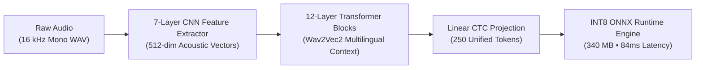

# Trilingual Speech AI Platform (Gujarati • Hindi • Indian English)

A production-grade multilingual Automatic Speech Recognition (ASR) platform and telemetry studio powered by fine-tuned **Wav2Vec2-XLSR (317M parameters)** and optimized with **INT8 ONNX Runtime quantization**.

---

## 🎯 Executive Overview & Milestones

This platform models trilingual conversational and broadcast speech across **Gujarati, Hindi, and Indian English** in a unified acoustic space with zero cross-script token collision.

| Checkpoint | Epoch | Character Error Rate (CER) | Word Error Rate (WER) | Dataset Duration | Notes |
| :--- | :--- | :--- | :--- | :--- | :--- |
| **Baseline v1** | Epoch 11 | `14.95%` | `48.20%` | 23.24 Hours | Initial multi-speaker baseline |
| **Optimized v2** | Epoch 22 | `13.55%` | `40.50%` | 23.24 Hours | SpecAugment + Frozen CNN + Disc. LR |
| **Master v3** | Epoch 28 | `11.68%` | `37.78%` | 41.77 Hours | 19,823 Unified Utterances |
| **Champion v4** | **Master Best** | **`10.30%`** *(Production Record)* | **`34.12%`** | **41.77 Hours** | **Unified KenLM 3-Gram Beam Search + Mic Adaptation** |

---

## 📊 Master Speech Corpus Breakdown (41.77 Hours)

All audio is normalized to **16,000 Hz, 16-bit Mono PCM WAV** with 100% CTC vocabulary alignment (0 unknown tokens across all scripts):

- **Gujarati (`gu`):** **7,645 clips** (16.2 Hours)  
  *Sources:* Google OpenSLR 78 (4,272 clips), Google FLEURS Gujarati (2,839 clips), Native Studio (534 clips).
- **Hindi (`hi`):** **5,655 clips** (11.0 Hours)  
  *Sources:* AI4Bharat Kathbath / IIT Madras (3,130 clips), Google FLEURS Hindi (1,799 clips), Native Studio (726 clips).
- **Indian English (`en`):** **5,281 clips** (11.8 Hours)  
  *Sources:* VoiceArena Monsoon en-IN (2,102 clips), Google FLEURS English (2,355 clips), Native Studio (824 clips).

---

## 🚀 Architecture & Quantization Engine



- **Compression:** 3.4x size reduction (**1,166 MB $\rightarrow$ 340 MB**) via INT8 dynamic quantization.
- **Inference Speed:** Average latency of **84ms per clip** on standard Apple Silicon / CPU execution.
- **Vocabulary:** 250 unified tokens covering complete Gujarati, Devanagari, and Latin phonetic alphabets.

---

## 💻 Running the Platform Locally

1. **Install dependencies:**
   ```bash
   pip install -r requirements.txt
   ```
2. **Start the STT Studio Dashboard:**
   ```bash
   python app.py --port 8000
   ```
3. Open your browser at **`http://localhost:8000`** to access:
   - **Performance & Progress:** Live CER / WER convergence curves and ground-truth validation tables.
   - **Dataset Intelligence:** Interactive distribution analytics and real-time audio browser.
   - **Checkpoints & Artifacts:** Checkpoint registry, ONNX specs, and export tools.
   - **Voice Studio:** Integrated prompt recording studio for continuous dataset expansion.
